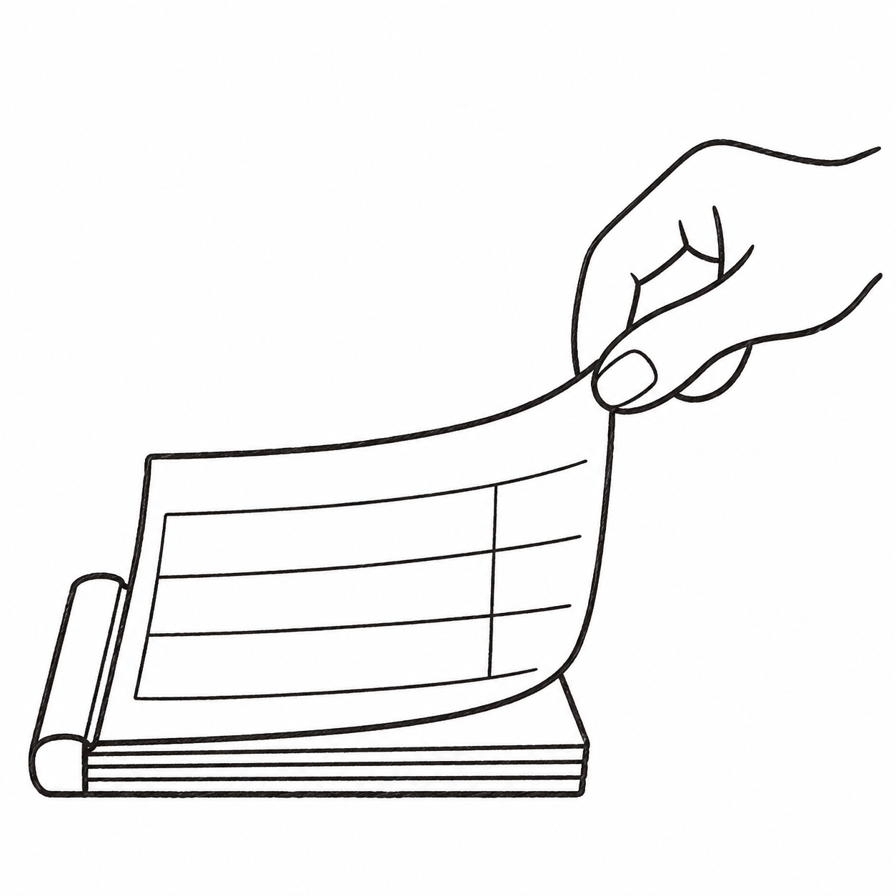

<p align="center">
  
</p>

<h1 align="center">Reimbursement Print</h1>

<p align="center">
  Give Codex a receipt folder. Get editable Chinese reimbursement forms and A4 evidence sheets for review, printing and cutting.
</p>

<p align="center">
  <a href="LICENSE">MIT license</a> · <a href="references/setup.md">Setup &amp; commands</a> · <a href="CONTRIBUTING.md">Contribute</a>
</p>

## Start in Codex

**Excel filling requires Codex's `@oai/artifact-tool` runtime package; ordinary Node.js alone is insufficient.** PDF helpers use Python. See [setup](references/setup.md) for dependencies and runtime discovery.

Install the skill:

```powershell
git clone https://github.com/SEKKAIE/reimbursement-print-skill.git "$HOME/.codex/skills/reimbursement-print"
```

Then give Codex your folder:

```text
Use $reimbursement-print to process the receipts in <my receipt folder>.
Keep unknown details blank, flag missing evidence, and prepare editable forms and A4 print packs.
```

中文也可以：`使用 $reimbursement-print 处理这个票据文件夹，填写报销表单并准备打印材料。`

<details>
<summary>Install from ZIP or update an existing copy</summary>

Extract the ZIP and place its folder at `~/.codex/skills/reimbursement-print`. That folder must directly contain `SKILL.md`, `agents`, `references` and `assets`. Refresh or restart Codex if the skill is not discovered.

To update a Git installation with no local edits, run `git pull --ff-only` inside the installed folder. Keep real jobs, profiles and outputs elsewhere.

</details>

## From folder to print pack

1. **Point to your files.** Supply invoice PDFs, payment screenshots and any bills, itineraries or approvals. No special filenames or extra XML/OFD downloads are needed.
2. **Match evidence and fill Excel.** Codex links documents to expense lines, flags missing details and fills a separate workbook for travel, ordinary expenses or client reception.
3. **Review, print and cut.** Check the amounts and missing inputs, print the prepared A4 sheets at **100%**, then cut along the guides. Signatures stay blank.

The helpers keep expenses separate from supporting payments, preserve original documents, match invoice–itinerary pairs and audit duplicates. Generated pages are recorded as prepared. Only user-confirmed printed pages are suppressed on a later run.

## Print once, cut twice

Four-up sheets use **one horizontal and one vertical division line**. Paper edges form the outside edges, so there are no individual rectangles to trim. Keep forms and categorized evidence in separate PDFs and omit only pages the user confirms already printed.

| Layout | Use | Arrangement |
| --- | --- | --- |
| Four-up | Receipts, screenshots, invoice–itinerary pairs | Landscape A4, four 148.5 × 105 mm pieces, two cuts |
| Two-up | Exported forms and larger evidence | Portrait A4, two 210 × 136 mm pieces, two cuts |
| Four strips | Optional legacy preference | Portrait A4, four 210 × 74.25 mm strips, three cuts |

Codex chooses a suitable preset, reviews whitespace-crop previews and checks readability. Original documents and editable templates stay intact. The generic cover starts at approximately 220 × 136 mm; confirm reduced width before using the two-up preset for a new organization. A 6 mm content inset keeps content clear of cuts and paper edges.

Print **100%, one PDF page per A4 sheet**. Do not apply another printer four-pages-per-sheet setting. See [layouts](references/print-layouts.md) and the [agent-authored print manifest](references/print-manifest.md).

<details>
<summary>Runtime dependencies and what the helpers produce</summary>

- **Checks and PDF packing:** Python with Pillow, pypdf, reportlab and pypdfium2. Tested versions are in [requirements.txt](requirements.txt).
- **Excel filling:** Node.js and Codex's **`@oai/artifact-tool`** package. Ordinary Node alone is insufficient; runtimes are not bundled.
- **Outputs:** a filled XLSX, supporting-document PDFs and review reports. A combined cover-plus-evidence PDF requires Codex to export the selected worksheets and assemble them with an available spreadsheet/PDF tool.

[Setup and exact commands](references/setup.md) cover dependency discovery and each helper. Windows with Codex is the current tested environment; other hosts and physical printers require their own checks.

</details>

<details>
<summary>Privacy and limits</summary>

This repository contains generic templates, code and synthetic examples. Keep real receipts, organization profiles, banking details and generated claims **outside the repository**. Configure actual names and rules locally; unknown fields stay blank.

The skill works inside Codex. It does not authenticate invoices, approve or submit claims, make payments, monitor folders or operate a printer. Outputs remain drafts for review. Receipt uploads to an external OCR service require authorization.

</details>

## Resources and contributions

- [Skill instructions](SKILL.md) · [Setup and commands](references/setup.md)
- [Job contract](references/job-contract.md) · [JSON schema](assets/package/schema/job.schema.json) · [Empty example](assets/package/schema/job.example.json)
- [Blank Excel master](assets/package/forms/reimbursement-forms.xlsx) · [Cell map](assets/package/forms/field-map.json)
- [Form filler](assets/package/forms/fill_forms.mjs) · [Print-sheet packer](assets/package/scripts/print_sheets.py) · [Crop-preview helper](assets/package/scripts/prepare_print_views.py)

Fork or create a branch, use synthetic test data, and open a pull request. [Contribution guidance](CONTRIBUTING.md) includes the required checks. Repository permissions control direct pushes; sharing the URL does not grant write access, and collaborator invitations remain a separate owner action.
